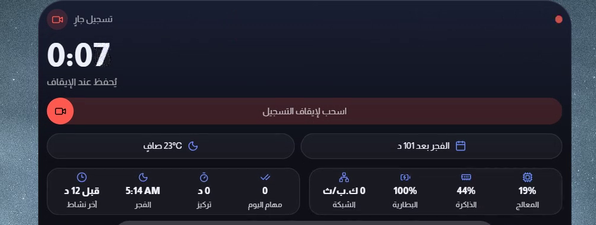
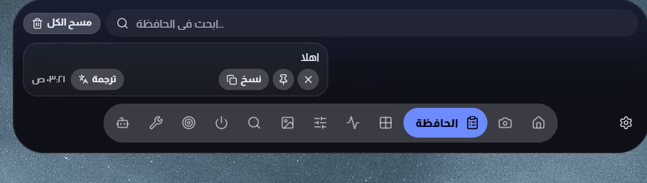
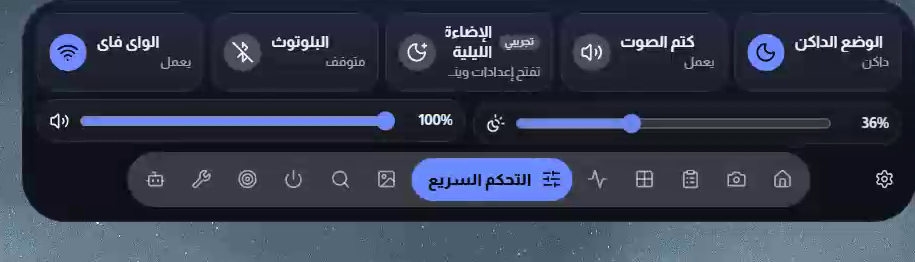
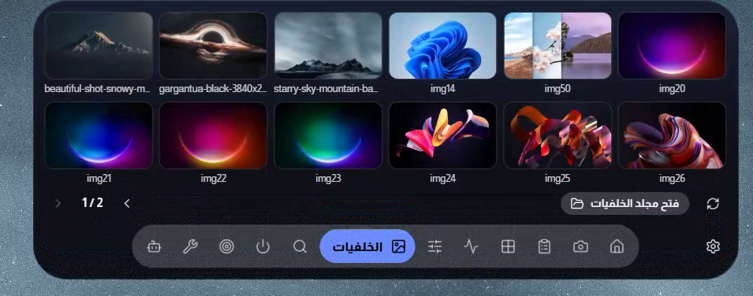

  

<h1 align="center">جزيرتي</h1>

  جزيرة ديناميكية ذكية لنظام Windows — أوقات الصلاة، إحصائيات جهازك، تحكم سريع، ورفيق هاتف، كلها في كبسولة صغيرة أنيقة فوق شاشتك.

<i>A smart Dynamic Island for Windows.</i>

  
  
  

  <a href="https://github.com/waliddawood999-ctrl/my-island-releases/releases/latest/download/MyIsland_1.0.137_x64-setup.exe"><b>⬇️ تحميل جزيرتي لنظام Windows</b></a>

  الإصدار الحالي: <b>1.0.137</b>

## ✨ المميزات

- 🕌 **أوقات الصلاة والتقويم الهجري** — مواقيت دقيقة مع عدّاد تنازلي للصلاة القادمة
- 📊 **إحصائيات جهازك لحظيًا** — المعالج، الذاكرة، البطارية، والشبكة
- 🎛️ **تحكم سريع** — واي فاي، بلوتوث، سطوع، صوت، والوضع الليلي
- 🖼️ **خلفيات** — غيّر خلفية سطح مكتبك من الجزيرة مباشرة
- 📋 **الحافظة** — كل ما نسخته، مع بحث وترجمة
- 🍅 **بومودورو ومهام** — ركّز بجلسات منظمة وتابع مهام يومك
- 📱 **رفيق الهاتف** — تحكم بجهازك من جوالك عبر نفس الشبكة
- 🤖 **مساعد ذكاء اصطناعي** — اسأل، اكتب، وتحكم بالشاشة بالأوامر
- 👁️ **عيون الكبسولة** — شخصية حيّة تتابعك، ترمش، وتنام عند الخمول
- 🎨 **ثلاثة ثيمات أنيقة** — أسود ذهبي، عاجي، وسديمي

## 📸 لقطات من التطبيق

## 💻 التثبيت

1. حمّل ملف التثبيت من الرابط بالأعلى.
2. شغّل الملف واتبع خطوات التثبيت.
3. ستظهر الجزيرة أعلى شاشتك — اضغط عليها لفتحها.

## 💬 تواصل معنا

للاقتراحات أو الإبلاغ عن مشكلة: **Walidwork.8@gmail.com**
